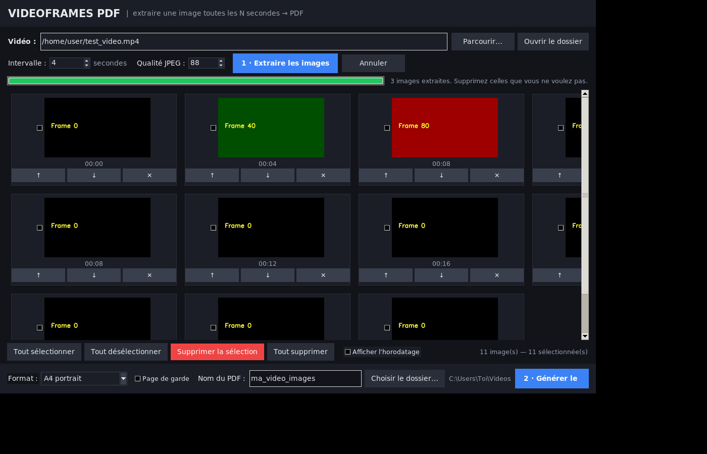

# VideoFramesPDF

Logiciel de bureau (Windows) qui **extrait une image toutes les N secondes** d'une
vidéo, vous laisse **supprimer les images que vous ne voulez pas**, puis crée un
**PDF** avec toutes les images restantes, **dans le même ordre**.



---

## ✨ Ce que ça fait

| Étape | Dans l'application |
|---|---|
| 1 | **Parcourir…** → vous choisissez la vidéo sur votre PC |
| 2 | **1 · Extraire les images** → une image toutes les 4 s (intervalle réglable) |
| 3 | La **galerie** affiche toutes les images : `✕` pour supprimer, `↑` `↓` pour réordonner |
| 4 | Vous indiquez le **nom du PDF** et le **dossier** de destination |
| 5 | **2 · Générer le PDF** → le fichier est créé, dans l'ordre affiché |

Bonus : double-clic sur une vignette = aperçu en grand. Case à cocher pour
inclure/exclure une image sans la supprimer.

---

## 📥 Téléchargement

### Windows — un seul fichier
|Download **`VideoFramesPDF.exe`** (~70 Mo)|
|:--:|

Double-cliquez dessus, c'est tout. **Aucune installation, aucun Python requis.**

> Windows peut afficher « Windows a protégé votre PC » (le logiciel n'est pas
> signé). Cliquez sur **Informations complémentaires** → **Exécuter quand même**.

### Windows — version script
Double-cliquez sur `Lancer VideoFramesPDF.bat` : le script installe tout ce qu'il
faut et lance le logiciel. Nécessite Python 3.9+.

### Depuis les sources
```bash
pip install -r requirements.txt
python app.py
```

---

## 🖥️ Interface

- **Vidéo** — chemin de la vidéo + boutons *Parcourir…* / *Ouvrir le dossier*
- **Intervalle** — en secondes (0,5 à 600), par défaut 4
- **Qualité JPEG** — de 40 (petit fichier) à 100 (qualité maximale)
- **Galerie** — vignettes horodatées, `✕` / `↑` / `↓` par image
- **Format** — A4 portrait / paysage, Letter portrait / paysage
- **Page de garde** — optionnelle, avec le nom du PDF et le nom de la vidéo

---

## ❓ Questions fréquentes

**Est-ce que mes données sont envoyées sur Internet ?**
Non. 100 % hors ligne, aucune donnée ne sort de votre PC.

**Ça marche avec quels formats ?**
mp4, avi, mkv, mov, wmv, flv, webm, m4v, mpg, mpeg, 3gp, ts.

**Une longue vidéo, ça rame ?**
Non : le logiciel va directement chercher l'image à la bonne position au lieu
de lire toute la vidéo image par image.

**Pourquoi mon PDF est lourd ?**
Le PDF contient les photos en JPEG. Baissez la *Qualité JPEG* (60–75) ou
choisissez le format paysage pour diviser le poids par deux.

---

## 🧱 Comment c'est fait

| Fichier | Rôle |
|---|---|
| `app.py` | Interface graphique Tkinter + fils d'exécution |
| `video_frames.py` | Extraction des images avec OpenCV (accès direct par timestamp) |
| `pdfwriter.py` | Générateur PDF maison — **aucune dépendance**, écrit les JPEG en `DCTDecode` |
| `requirements.txt` | Dépendances Python |
| `build_exe.bat` | Construit l'exécutable Windows avec PyInstaller |
| `Lancer VideoFramesPDF.bat` | Installe les dépendances et lance le logiciel |

Le PDF est écrit à la main (structure PDF 1.4, table xref, objets XObject) :
pas de ReportLab, pas de fpdf — le fichier `.exe` reste léger et le PDF
s'ouvre partout (Acrobat, Reader, Edge, Preview, LibreOffice…).

## 📄 Licence

MIT — utilisez-le, modifiez-le, redistribuez-le librement.
